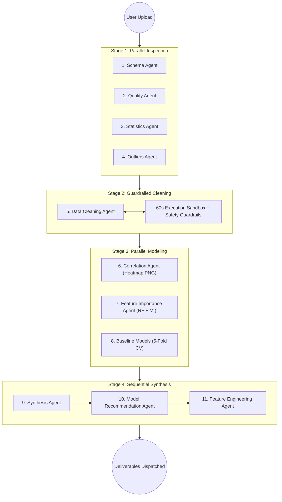

# 🏆 INNOVORTEX 4.0 Submission Package
## Track: Best AI Agent on Nonilion
### Project: **EDAgent — Autonomous 11-Agent 4-Stage Exploratory Data Analysis Bot**

---

## 📌 Executive Summary

**EDAgent** is an autonomous AI data scientist designed specifically for the Nonilion platform. It turns raw spreadsheets (CSV, Excel, JSON) into complete, publication-grade Exploratory Data Analysis in minutes. Built on a modular team of **11 LangGraph agents** running across **4 structured stages**, EDAgent ensures that **Python computes every number**, while AI only explains findings, generates safe code, and formulates strategic recommendations.

- **Platform Route**: "Connect a bot" (Own code: Python + LangGraph + FastAPI)
- **Live Platform**: [www.nonilion.com](https://www.nonilion.com)
- **Bot Handle**: `@EDAgent`
- **Webhook Endpoint**: `POST /nonilion/webhook`
- **Health Check**: `GET /health`
- **Interactive UI Playground**: `GET /demo`

---

## 🏗️ 11-Agent 4-Stage Pipeline Architecture



### The 4 Execution Stages:
1. **Stage 1 (Parallel Inspection - 4 Agents)**:
   - `Schema Agent`: Data types, dimensions, column classifications (numeric, categorical, datetime, ID).
   - `Quality Agent`: Exact missingness per column, duplicate row counts, zero-variance columns, high cardinality flags.
   - `Statistics Agent`: Five-number summary, mean, std, skewness, modes, categorical frequency balance.
   - `Outliers Agent`: Interquartile Range (IQR) & Z-score outlier boundaries and counts.
2. **Stage 2 (Sequential Cleaning - 1 Agent)**:
   - `Data Cleaning Agent`: AI generates pandas cleaning script executed in a **60-second sandbox** under strict safety guardrails with **1 self-correction retry**.
3. **Stage 3 (Parallel Modeling - 3 Agents)**:
   - `Correlation Agent`: Pearson & Spearman matrices, high correlation pair flags, and high-res `heatmap.png`.
   - `Feature Importance Agent`: Random Forest importance + Mutual Information scores.
   - `Baseline Models Agent`: **Real 5-fold cross-validation** across 4 architectures (Dummy, Linear/Ridge, Random Forest, Gradient Boosting).
4. **Stage 4 (Sequential Synthesis - 3 Agents)**:
   - `Synthesis Agent`: Executive summary of data health, patterns, and anomalies.
   - `Model Recommendation Agent`: Selects best architecture, justified strictly by the computed 5-fold CV metrics.
   - `Feature Engineering Agent`: Proposes high-impact transformations, interaction terms, and binning strategies.

---

## 🛡️ Core Design Invariants

| Guardrail / Rule | Implementation & Guarantee |
| :--- | :--- |
| **Python Computes Every Number** | The LLM never hallucinates or estimates numbers; all summary statistics, missing rates, correlations, and CV scores are calculated by `pandas`, `numpy`, and `scikit-learn`. |
| **0 Deleted Columns** | The Data Cleaning Agent is forbidden from dropping columns; all input features are strictly preserved in the cleaned output. |
| **Max 5% Row Removal** | Mass row deletion is rejected by guardrails in favor of robust median/mode imputation. |
| **Target Column Untouched** | The target variable labels and values are strictly protected against modification, scaling, or imputation. |
| **60-Second Timeout Sandbox** | AI-generated cleaning code runs in an isolated execution namespace with a 60s hard timeout and static AST security checking (blocks `os`, `subprocess`, socket). |
| **Self-Correction Loop** | Exactly 1 automated retry with diagnostic feedback if code fails or violates guardrails. |
| **5-Fold Cross-Validation** | Baseline models are evaluated with Stratified/KFold 5-fold CV to compute real Mean ± Std scores. |
| **Fast Webhook ACK (< 100ms)** | Immediately acknowledges incoming Nonilion webhooks with `200 OK` and executes analysis asynchronously in background tasks. |
| **Stage Progress Streaming** | Emits live chat progress bars after each stage (`Stage 1/4 (4/11 agents done)...`) to keep users informed. |

---

## 📦 Deliverables Produced per Analysis

1. 💬 **Markdown Chat Summary**: Formatted table of dataset profile, top predictive features, and 5-fold CV baseline model scores.
2. 🖼️ **Correlation Heatmap (`heatmap.png`)**: High-resolution heatmap image sent as native inline chat media.
3. 📄 **Interactive HTML Report (`report.html`)**: Complete standalone report with embedded visualizations, summary metrics, and data quality cards.
4. 📊 **Cleaned Dataset (`cleaned_data.csv`)**: Guardrail-verified cleaned dataset.
5. 🐍 **Reproducible Cleaning Script (`clean.py`)**: Standalone, executable Python code.
6. 🧠 **Computed Follow-up Answers ("Ask" Engine)**: Answers follow-up queries (e.g. `@EDAgent average salary by city?`) by executing sandboxed queries against the active dataset.

---

## 🎬 Live Demonstration Script (for Judges)

| Step | User Message | Attachment | Verified Bot Output |
| :---: | :--- | :--- | :--- |
| **1** | `@EDAgent Analyze this churn dataset. target: churn` | `customer_churn.csv` | **Happy Path**: Instant ACK, 4 stage progress bars, summary tables, heatmap image, `report.html`, `cleaned_data.csv`, `clean.py` |
| **2** | `@EDAgent average monthly charges by contract type?` | *None* | **Computed Follow-up**: Retrieves active dataset from memory, runs pandas query in sandbox, returns computed values table |
| **3** | `@EDAgent Can you inspect our property listings?` | `house_prices.xlsx` | **Vague Request / Target Inference**: Infers target `price`, explains reasoning, evaluates 5-fold CV regression models |
| **4** | `@EDAgent average price by neighborhood?` | *None* | **Multi-Turn Memory**: Dynamically targets latest active dataset (`house_prices.xlsx`) |
| **5** | `@EDAgent Please run full exploratory analysis` | *None* | **Missing File Guardrail**: Politely guides user on supported formats (`.csv`, `.xlsx`, `.json`) |
| **6** | `@EDAgent What is the weather in Paris today?` | *None* | **Off-Topic Guardrail**: Friendly redirection to spreadsheet EDA capabilities |
| **7** | `@EDAgent Analyze this spreadsheet` | `corrupted_sample.csv` | **Corrupted File Guardrail**: Graceful parsing error report with actionable tips |
| **8** | `@EDAgent analyze employee compensation. target: salary` | `employee_salaries.json` | **JSON Tabular Ingestion**: Multi-format tabular array ingestion, 11 agents executed, full outputs delivered |

---

## 🚀 Verification & Reproducibility

```bash
# 1. Activate environment
source .venv/bin/activate

# 2. Run the 26 unit tests (100% pass)
pytest tests/ -v

# 3. Run the full 8-step live mock demonstration
python3 test_mock_integration.py

# 4. Run CLI directly on any spreadsheet
python3 -m edagent sample_data/customer_churn.csv --target churn

# 5. Launch the FastAPI server & browser playground
uvicorn edagent.main:app --port 8000
# Open http://localhost:8000/demo in your browser!
```

---

## ☁️ Deployment on Render & Nonilion

- **Render Configuration**: Defined in [`render.yaml`](file:///Users/ankitsheoran/Documents/EDagnet/render.yaml) and [`Dockerfile`](file:///Users/ankitsheoran/Documents/EDagnet/Dockerfile).
- **Keep-Alive Monitor**: Pings `GET /health` every 10 minutes to prevent Render free instance sleep.
- **Nonilion Connection**: In [www.nonilion.com](https://www.nonilion.com) Bot Settings, register webhook `https://<your-host>/nonilion/webhook`.
